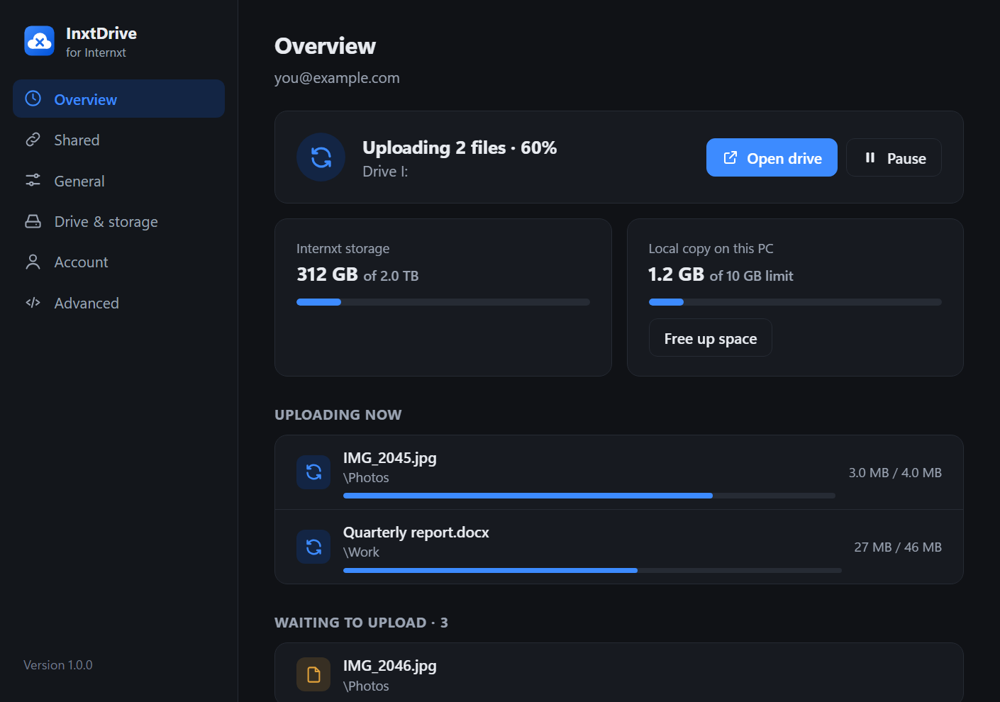
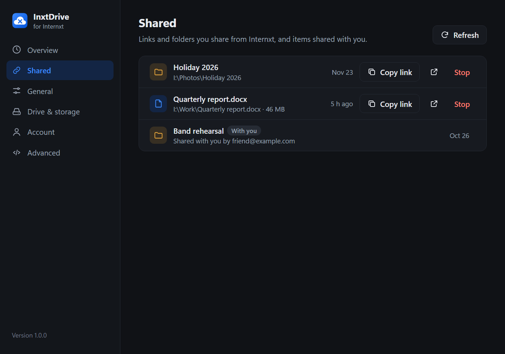
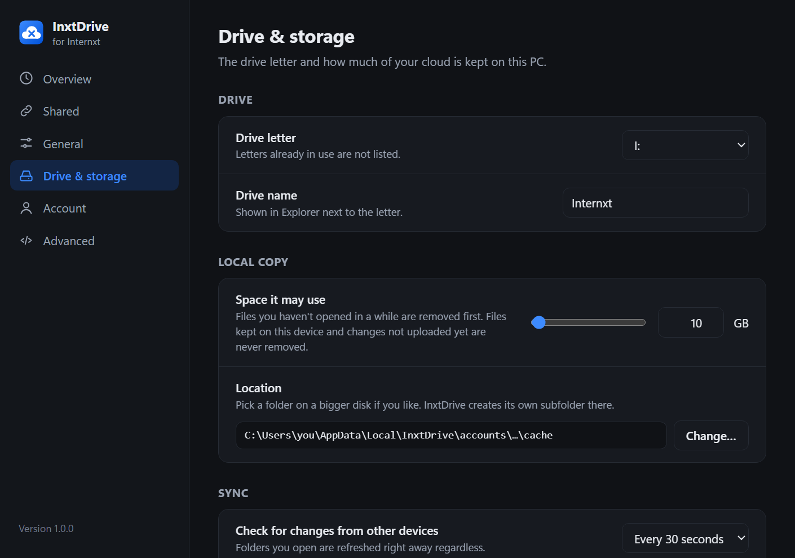
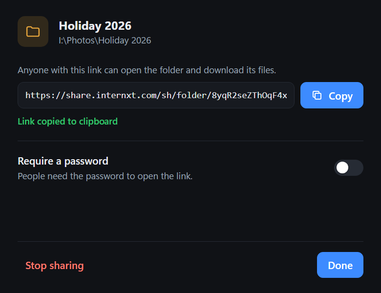

# InxtDrive

Your [Internxt](https://internxt.com) cloud storage as a real drive in Windows Explorer, or as a folder on Linux.

InxtDrive mounts your Internxt Drive as a drive letter (for example `I:`), the way pCloud Drive and Icedrive do.
On Linux it appears as a folder, `~/Internxt` by default.
Everything in your account shows up instantly without taking disk space. Files download on demand when you open
them, and anything you save, copy, rename or delete on the drive is synced back to your account in the background.

> **Unofficial.** InxtDrive is an independent open-source project. It is not made, endorsed or supported by
> Internxt. It talks to the same public API the official open-source clients use.

## Why this exists

I wanted my Internxt storage to be part of Windows Explorer the way OneDrive, Google Drive and pCloud are: a mounted
drive with every file visible, contents downloaded only when opened, status icons, and right-click actions such as
share links and freeing up space. The official desktop app does not work that way, and I find it clunky to use.
InxtDrive is the client I wanted, built on the same encrypted Internxt storage.

## Screenshots

| Overview | Shared |
|---|---|
|  |  |
| **Drive & storage** | **Share link** |
|  |  |

## Features

- **Real drive letter** in File Explorer, with an entry in the navigation pane. Works with any app: Office,
  editors, media players, `cmd`, PowerShell, robocopy.
- **Files on demand.** The whole folder tree is available immediately. File contents are fetched when read,
  using ranged downloads, so a video can start playing or a large archive can be inspected without downloading
  all of it.
- **End-to-end encryption, as in the official apps.** Files are encrypted on your PC (AES-256-CTR with keys
  derived from your account's recovery words) before upload, and decrypted after download. Internxt only ever
  stores ciphertext.
- **Write-back sync.** Saves are local-speed. Changes upload after a short quiet period, survive restarts and
  wait out network outages.
- **Plays well with editors.** When an app saves through a temporary file (Word, Excel, most editors), the
  existing cloud file is updated in place instead of being deleted and re-created, so its history is kept.
- **Changes from other devices** appear on the drive within seconds (polling interval is configurable).
- **Conflict safety.** If a file is edited here and elsewhere at the same time, your local version is kept as
  `name (conflict <date>).ext` next to the other one. Nothing is overwritten silently.
- **Deletes go to the Internxt trash**, so they can be restored from the web app.
- **Status icons in Explorer**: a green check on files and folders that are in your Internxt account, blue arrows
  on anything still uploading.
- **Share links** from the right-click menu, compatible with the Internxt web app (optionally password protected),
  and a **Shared** view listing everything you share, with copy link and stop sharing.
- **Bounded local cache** (10 GB by default) with least-recently-used eviction. "Always keep on this device" and
  "Free up space" are available from the right-click menu in Explorer.
- **App window** with live activity (uploading now, waiting, recently uploaded, problems), storage usage and all
  settings. Tray icon for quick status, pause/resume and sign in/out.

## Install

1. Download `InxtDrive-Setup-<version>.exe` from the releases page and run it.
   The installer also installs [WinFsp](https://winfsp.dev), the open-source file system driver InxtDrive
   uses, if it is not already present (version 2.0 or newer).
2. InxtDrive starts and opens a sign-in page in your browser. Choose **Continue with Internxt sign-in** (the same
   web sign-in the official desktop app uses; two-factor authentication works there) or use email and password.
3. The first time, InxtDrive indexes your account (a few seconds to a few minutes depending on the number of
   files), then the drive appears in Explorer.

Status icons appear after Windows Explorer restarts. Tick the option at the end of setup, use
**Advanced → Restart Explorer…** in the app, or sign out of Windows and back in.

The installer is not code-signed yet, so Windows SmartScreen may ask you to confirm ("More info" → "Run anyway").

Do not run InxtDrive "as administrator": Windows hides drives mounted by elevated programs from your normal
Explorer windows.

### Linux

Pick the package for your distribution from the releases page:

| Distribution | File | Install |
|---|---|---|
| Debian 12+, Ubuntu 22.04+, Mint | `inxtdrive_<version>-1_amd64.deb` | `sudo apt install ./inxtdrive_<version>-1_amd64.deb` |
| Fedora, openSUSE | `inxtdrive-<version>-1.x86_64.rpm` | `sudo dnf install ./inxtdrive-<version>-1.x86_64.rpm` |
| Arch, Manjaro, EndeavourOS | `inxtdrive-<version>-1-x86_64.pkg.tar.zst` | `sudo pacman -U ./inxtdrive-<version>-1-x86_64.pkg.tar.zst` |
| Anything else | `InxtDrive-<version>-x86_64.AppImage` | `chmod +x` it and run it |

Then start **InxtDrive** from the application menu. Sign-in works as on Windows. The drive appears in
`~/Internxt` (it must be an empty folder; change it under **Drive & storage**) and as a bookmark in GTK file
managers' sidebars. The packages pull in what they need (FUSE 3, WebKitGTK, the tray library); the AppImage needs
`fuse3` from your distribution. GNOME shows the tray icon only with the AppIndicator extension, which Ubuntu,
Fedora and most other desktops already ship or enable.

## Using it

- **Tray icon**: left-click opens the drive. Right-click shows status and actions, including **Settings…**
  (opens the app window).
- **Explorer right-click** on files and folders on the drive (under "Show more options" on Windows 11):
  - *Share link…* creates a public link (or shows the existing one), copies it, and lets you add a password or
    stop sharing.
  - *Always keep on this device* downloads them and exempts them from cache cleanup.
  - *Free up space* removes the local copy. The files stay in the cloud.
- **On Linux**, the same three actions appear in Nautilus (right-click > Scripts > InxtDrive), Dolphin
  (InxtDrive submenu) and Nemo once the drive is connected. The tray menu has **Open drive**, because Linux
  tray icons only open their menu on click.
- **Command line** (`inxt.exe` in the install folder on Windows, `inxt` on Linux):

  ```text
  inxt status                  state of the running app
  inxt pin|unpin|free <path>   same as the Explorer actions
  inxt login [--password]      sign in and save the session
  inxt logout                  forget the saved session
  inxt mount                   run the drive in a console window (for troubleshooting)
  inxt paths                   where settings, data and logs are kept
  ```

## Settings

Tray menu → **Settings…** opens the app window. Changes apply when you press **Save changes**; changing the drive
letter or moving the local copy reconnects the drive for a moment, without restarting the app.

| Tab | What you can change |
|---|---|
| General | Start with Windows, status icons in Explorer, keep Explorer from downloading files just to preview them |
| Drive & storage | Drive letter and name, how much disk the local copy may use and where it lives, how often to check for changes from other devices, uploads in parallel |
| Account | Storage usage, open the web app, sign out |
| Advanced | File system name, log detail, connection settings, log folder, restart Explorer |

Settings are stored in `%APPDATA%\InxtDrive\config.toml` (Linux: `~/.config/InxtDrive/config.toml`). On Linux
the General tab has **Start when you log in** and Drive & storage has the mount folder instead of a drive letter.

## Privacy and security

- Your session token and recovery words are stored with Windows DPAPI in `%LOCALAPPDATA%\InxtDrive\session.dat`,
  readable only by your Windows user on this PC. They are never logged. On Linux the session file
  (`~/.local/share/InxtDrive/session.dat`) is encrypted with a key kept in your desktop keyring (GNOME Keyring,
  KWallet, KeePassXC); without a keyring the key is a file only your user can read.
- With the browser sign-in your password never reaches InxtDrive. With email/password sign-in it is used once on
  your PC to derive the login proof and decrypt your keys, the same way the official apps do it, and is not stored.
- The local cache under `%LOCALAPPDATA%\InxtDrive\accounts\` holds **decrypted** copies of files you opened, like
  every sync client. It is protected by your Windows account; use BitLocker if your disk needs encryption at rest.
  Signing out deletes it.
- No telemetry. InxtDrive only talks to Internxt's API and storage endpoints.

## Limitations

- Windows 10 1809 or newer, x64. Linux x86_64 with glibc 2.35 or newer (Debian 12, Ubuntu 22.04 and later).
- Linux has no status icons on files yet, and names are matched case-insensitively (as on Windows), so `a.txt`
  and `A.txt` cannot sit in the same folder.
- Permissions, alternate data streams, hard links and symbolic links are not stored in the cloud.
- Files kept open for writing (databases, logs that never close) upload only after they are closed.
- Internxt plans without empty files refuse them. They stay on this device, are listed as a problem and are
  retried every hour.
- Windows shows only about 11 sets of Explorer status icons from all apps combined. InxtDrive's two sort after
  pCloud's and most other sync apps', ahead of some of OneDrive's. If another app takes the slots, InxtDrive's
  icons may not show; everything else keeps working.
- Internxt may restrict API access for some plans. InxtDrive uses the same endpoints as the official desktop app.

## How it works

```text
 Explorer / apps
       │  Windows file system calls
 ┌─────▼──────────┐   inxt-winfsp: WinFsp adapter (drive letter, change notifications)
 │  inxt-core     │   in-memory tree persisted to SQLite, sparse block cache,
 │                │   delta polling, write-back push queue, conflict handling
 └─────┬──────────┘
 ┌─────▼──────────┐   inxt-api: Internxt Drive + Network API, sign-in,
 │  inxt-api      │   key derivation, AES-256-CTR, multipart upload
 └────────────────┘
```

- `crates/inxt-api`: protocol client. Crypto is cross-checked against vectors produced independently with
  Node's OpenSSL (`tools/gen-vectors.mjs`).
- `crates/inxt-core`: the engine, with no OS dependencies.
- `crates/inxt-winfsp`: maps WinFsp callbacks to the engine.
- `crates/inxt-fuse`: the Linux counterpart, mapping FUSE requests to the engine (pure Rust, mounts through
  `fusermount3`).
- `crates/inxtdrive`: tray app and app window (`inxtdrive`, a WebView2 / WebKitGTK page in `src/ui/app.html`), CLI
  (`inxt`), sign-in, settings, sharing, Explorer and Linux file-manager integration.
- `crates/inxt-overlay`: the Explorer status-icon extension (`inxt_overlay.dll`). It decides from the drive letter
  and file attributes alone (the file system sets ARCHIVE for "not uploaded yet", PINNED/UNPINNED for "in the
  cloud"), so Explorer never waits on the network or the app.
- `crates/inxt-mock`: an in-memory stand-in for the Internxt API used by the tests (never shipped).

## Building

Requirements: Rust (stable, MSVC toolchain), Visual Studio Build Tools, Node.js (only to regenerate icons and test
vectors), [Inno Setup 6](https://jrsoftware.org/isdl.php) for the installer. The WinFsp bindings ship pregenerated,
so LLVM/libclang is not needed.

```powershell
cargo test --workspace                 # unit + end-to-end tests against the mock API
cargo test -p inxt-core --release --test e2e -- --include-ignored   # adds a 105 MiB multipart test
cargo build --release                  # target\release\inxtdrive.exe and inxt.exe
.\scripts\build-installer.ps1          # dist\InxtDrive-Setup-<version>.exe
```

On Linux (Arch shown; other distributions need the matching `-dev` packages):

```sh
sudo pacman -S --needed rust pkgconf webkit2gtk-4.1 gtk3 libayatana-appindicator fuse3 dbus podman
cargo test --workspace
scripts/linux/build-packages.sh          # dist/: .pkg.tar.zst, .deb, .rpm, .AppImage
scripts/linux/build-packages.sh arch     # only the Arch package
```

The .deb, .rpm and AppImage are built in an Ubuntu 22.04 container (podman or docker) so they run on older
distributions too; the Arch package is built natively with `makepkg`.

To try the drive without an account, run the mock API and point a throwaway profile at it:

```powershell
$env:INXTDRIVE_HOME = "$env:TEMP\inxtdrive-dev"
cargo run --release -p inxt-mock        # prints the URL and a token
# put gateway_url = "<that URL>" in $env:INXTDRIVE_HOME\config.toml, then:
"<token>`nlegal winner thank year wave sausage worth useful legal winner thank yellow" | inxt login --token-stdin
inxt mount
```

## License

InxtDrive is free software under the [GNU General Public License v3.0 or later](LICENSE).

It links [winfsp-rs](https://github.com/SnowflakePowered/winfsp-rs) (GPL-3.0, vendored under `vendor/winfsp-sys`
with a modified build script) and uses [WinFsp](https://github.com/winfsp/winfsp) (GPL-3.0 with a FLOSS
exception), whose unmodified installer is bundled. On Linux it uses [fuser](https://github.com/cberner/fuser)
(MIT) and the system's FUSE 3. "Internxt" is a trademark of its owner and is used here only
to describe compatibility.
